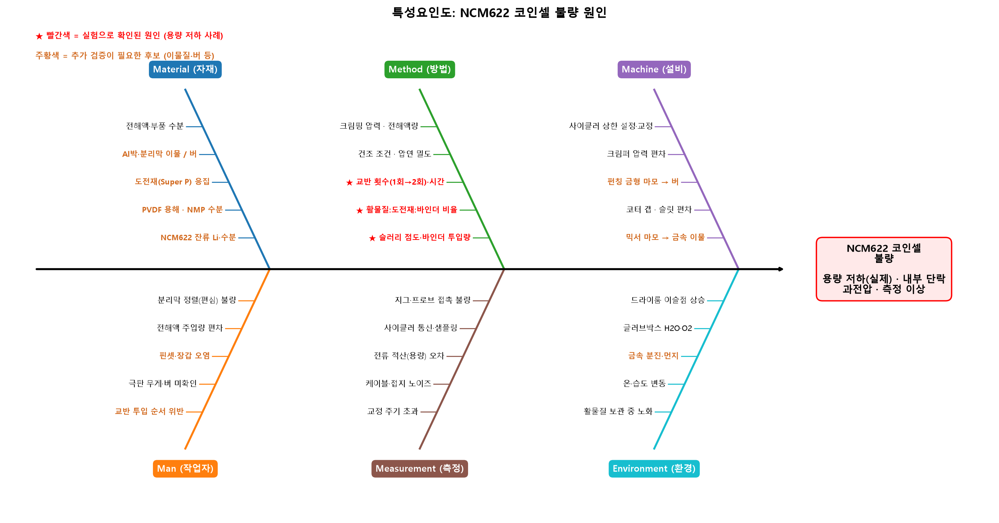

# NCM622 코인셀 불량 개선 프로젝트

Troubleshooting and optimization of coin-cell capacity anomalies and performance enhancement.

NCM622/Graphite 코인셀의 **용량 저하 불량**을 대상으로, 원인을 좁히고(4M·5-Why·특성요인도), 충방전 데이터를 전처리·분석해 불량을 자동으로 찾아 보정하고, 개선 효과를 확인한 프로젝트입니다. DMAIC(정의→측정→분석→개선→관리) 흐름으로 정리했습니다.

## 분석 대상
| 구분 | 내용 |
|---|---|
| **실제 불량 사례** | 초기 양극 샘플1(교반 1회)이 이론 용량의 **약 50%** 에 그침 → 셀을 해체해 비교한 결과 **슬러리 점도(바인더 과다 유입)와 교반 부족**이 원인 → 교반 2회로 개선한 추가 샘플(샘플2)이 정상 충방전 (이론 용량의 **96.8%**) |
| **불량 시나리오 데이터** | 정상 셀(샘플2) 충방전 데이터에 불량 6종(스파이크·내부 단락·고착·누락·과전압·용량 글리치)을 **주입해 만든 데이터**. 탐지·보정 알고리즘을 만들고 검증하는 데 사용 |

## 구성
| 노트북 | 내용 | 프로젝트 단계 |
|---|---|---|
| [`01_불량시나리오_생성.ipynb`](notebooks/01_불량시나리오_생성.ipynb) | 정상 데이터에 불량 6종 주입 | 데이터 준비 |
| [`02_전처리_분석_문제해결.ipynb`](notebooks/02_전처리_분석_문제해결.ipynb) | 데이터 점검, 불량 탐지 알고리즘, 자동 보정, 개선 효과 검증, 재현성 검증 | Measure · Analyze · Improve · Control |
| [`03_원인분석_4M_5Why.ipynb`](notebooks/03_원인분석_4M_5Why.ipynb) | 실제 불량 사례, 4M 표, 5-Why, 특성요인도, 부품 측정값 점검, 검증 계획(DOE) | 원인 좁히기 |

## 주요 결과 (불량 시나리오 데이터 기준)
| 항목 | 결과 |
|---|---|
| 단순 통계 기법(Z-score, IQR) | 불량을 하나도 찾지 못함 (재현율 0, 정상 구간의 급변을 오탐) |
| 제안 탐지 알고리즘 | 오탐 **0건**, 전체 재현율 **80.7%**, F1 **0.893** |
| 측정 오류 복원 (전압 RMSE) | 40.6 mV → **0.14 mV** |
| OCV 피팅 오차 (정상 기준 대비) | 2.84 mV → **0.34 mV** |
| ICA(dQ/dV) 오차 (RMSE) | 0.0037 → **0.0001** (약 38배 감소) |
| 불량 위치·크기를 바꾼 10개 시나리오 | 정밀도 평균 0.999, 재현율 평균 0.798 (최저 0.707) |
| 개선 후 정상 셀 34,864행 | 불량 판정 **0건** |

불량 유형별로는 데이터 누락·센서 고착·스파이크·용량 글리치를 100% 탐지했고, 과전압은 92.7%, 내부 단락은 74.1%를 탐지했습니다. 내부 단락 구간의 양 끝은 정상과 거의 구분되지 않아 놓칩니다.

## 실제 사례로 확인된 원인 (실험)
- 셀 해체 시 **점도 차이가 극명**했고, **표면 균일성이 낮았으며**, 코팅이 매우 얇아 집전체가 비쳐 보였습니다.
- 양극 질량은 샘플1이 샘플2의 **42%** 수준(3.57 mg vs 8.53 mg)으로, 해체 관찰과 일치합니다.
- 교반 1회 = (5분 교반 + 1분 휴지) × 5번, 개선은 이를 **2회** 수행했습니다.



## 실행 방법
```bash
pip install -r requirements.txt
```
노트북을 `01 → 02 → 03` 순서로 실행하세요(저장소 루트나 `notebooks/` 어디서 실행해도 됩니다). 생성되는 결과 파일은 `outputs/`에 저장되며 git에는 포함되지 않습니다. `data/불량 시나리오 데이터.xlsx`는 01이 만드는 파일이며 편의를 위해 포함했습니다.

Python 3.14, numpy 2.5, pandas 3.0, scipy 1.18, matplotlib 3.11, openpyxl 3.1에서 실행을 확인했습니다. 그림에는 `Malgun Gothic` 폰트를 사용하므로 Windows가 아니면 한글이 깨질 수 있습니다.

## 데이터
| 파일 | 설명 |
|---|---|
| `data/전압 및 용량 데이터.xlsx` | 정상 셀(샘플2, 0.2C 충방전)의 전압·용량 시계열 34,864행 |
| `data/전지설계 기말과제1 부품규격.xlsx` | 부품 치수, 전극 두께, 양극 질량, 사이클러 조건 측정값 (학생 이름은 학생1~5로 표기) |
| `data/불량 시나리오 데이터.xlsx` | 01이 만든 불량 시나리오 데이터와 정답 라벨 |

충방전 데이터의 컬럼명 `누적 용량_d(Ah/cm2)`는 면적당 값이 아니라 **셀 전체 Ah**로 보입니다. 충전 중 전류(0.2473 mA)와 충전 용량이 샘플2의 설계값과 일치하는 것으로 추정했습니다.

## 한계
- 교반 1회 vs 2회는 **각 1개 샘플**의 비교라서 사례 확인이며, 통계적 검증은 아닙니다. 점도는 수치 없이 관찰 결과만 있습니다.
- 탐지 성능은 불량을 주입한 시나리오 데이터 기준이므로, 실제 불량 셀 데이터에 적용할 때는 임계값(`PARAM`)을 다시 조정해야 합니다.
- 불량 시나리오 6종의 원인(4M·5-Why의 대부분)은 문헌과 공정 지식에 근거한 **가설**입니다. 노트북 03의 6절에 검증 계획(DOE)을 제시했습니다.
- 교반 장비·rpm·투입 순서는 기록이 없습니다.
